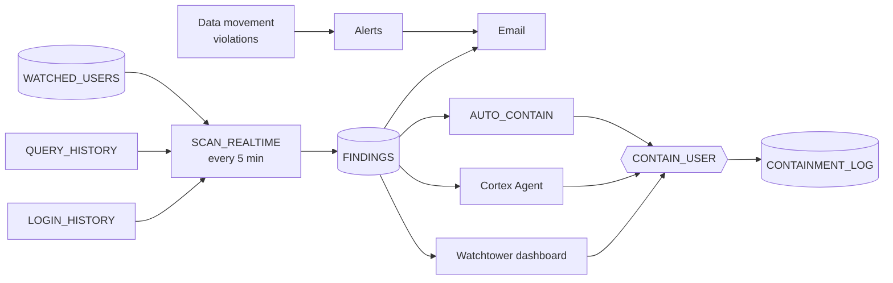
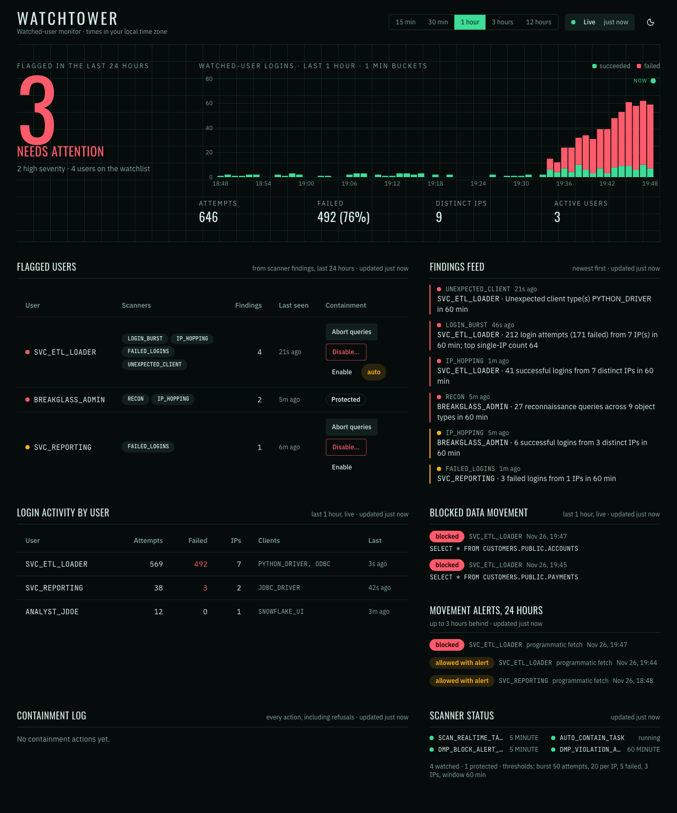
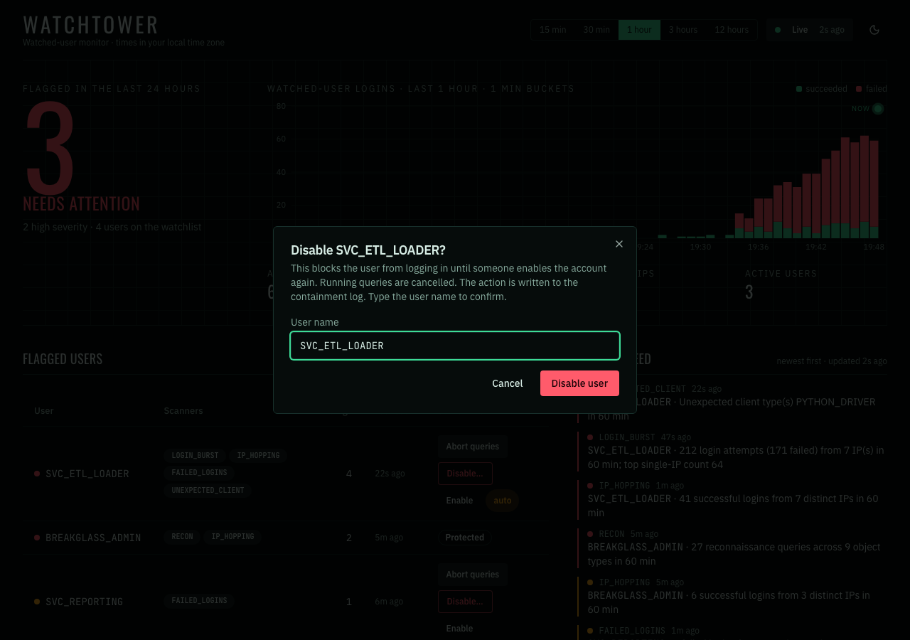
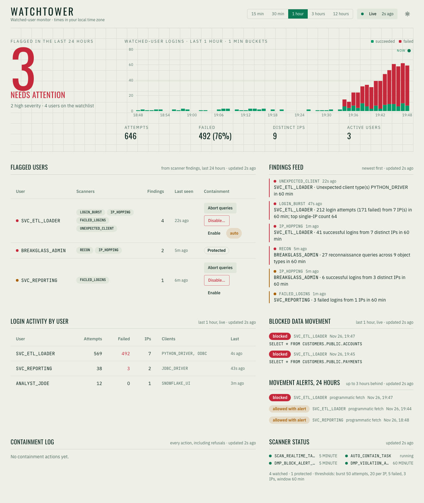

# Custom recon and IP scan for Snowflake

Detect reconnaissance, IP hopping, login bursts and unexpected clients for a chosen set of Snowflake users, get emailed, watch it live on a dashboard, and contain a flagged user with guarded actions. Built from plain Snowflake objects (tasks, alerts, procedures, a Cortex Agent, a Snowflake App Runtime app), not a Native App extension.

<p align="center">
  
</p>

<sub>Synthetic demo data (made-up users and numbers), generated by [`dashboard/scripts/capture_demo.py`](dashboard/scripts/capture_demo.py). No real account data is shown.</sub>

## Contents

- [What it does](#what-it-does)
- [Quick start](#quick-start)
- [Detections](#detections)
- [Watched population](#watched-population)
- [Containment and the Cortex Agent](#containment-and-the-cortex-agent)
- [Data movement controls](#data-movement-controls)
- [Watchtower dashboard](#watchtower-dashboard)
- [Configuration](#configuration)
- [Safety notes](#safety-notes)
- [Limitations](#limitations)
- [Repository layout](#repository-layout)
- [Cleanup](#cleanup)

## What it does



| Layer | What it gives you | Files |
|---|---|---|
| Hourly scanner | Recon by service users and multi-IP logins, from `ACCOUNT_USAGE` | `sql/01`, `sql/02` |
| Real-time scanner | Five detections on `INFORMATION_SCHEMA`, for watched users only, every 5 minutes | `sql/06` |
| Containment | Abort queries, disable or re-enable a user, with protected users, audit log and an optional automatic rule | `sql/07` |
| Cortex Agent | Chat triage of flagged users, with the containment procedure as a tool | `agents/` |
| Data movement | A sample row-limit policy plus two alerts for violations | `sql/03`, `sql/04`, `sql/05` |
| Dashboard | Live monitor with containment buttons | `dashboard/` |

## Quick start

You need ACCOUNTADMIN (or equivalent), the [Snowflake CLI](https://docs.snowflake.com/en/developer-guide/snowflake-cli/index), and `SNOWFLAKE.ACCOUNT_USAGE` access. Data movement policies need Enterprise Edition. Every SQL file uses placeholders (`<YOUR_DB>`, `<YOUR_WAREHOUSE>`, `<YOUR_VERIFIED_EMAIL>`, `<YOUR_WATCHED_USER>`, `<YOUR_PROTECTED_USER>`): replace them first. The email address must belong to a verified user in the account.

| Step | Run | Needs |
|---|---|---|
| 1. Core scanner | `snow sql -c <connection> -f sql/01_deploy.sql` | |
| 2. Try it (optional) | `snow sql -c <connection> -f sql/02_demo_run.sql` | 1 |
| 3. Real-time scanner | `sql/06_realtime_scanner_information_schema.sql` | 1 |
| 4. Containment | `sql/07_containment.sql`, then create the agent (see [below](#containment-and-the-cortex-agent)) | 3 |
| 5. Data movement policy (optional) | `sql/03_data_movement_policy.sql` | |
| 6. Violation alerts (optional) | `sql/04_dmp_violation_alert.sql`, `sql/05_dmp_block_alert_realtime.sql` | 3 |
| 7. Dashboard (optional) | see [`dashboard/README.md`](dashboard/README.md) | 4 |

Run `sql/02_demo_run.sql` with the `TRUST_SCANNER` schema selected (`USE SCHEMA <YOUR_DB>.TRUST_SCANNER;`). Tasks and alerts are created suspended. Start them when you are ready:

```sql
ALTER TASK SCAN_REALTIME_TASK RESUME;
ALTER ALERT DMP_VIOLATION_ALERT RESUME;
ALTER ALERT DMP_BLOCK_ALERT_REALTIME RESUME;
```

## Detections

| Scanner | Detects | Source | Delay |
|---|---|---|---|
| `RECON_SYSTEM_USER` | Service users (`TYPE` = SERVICE or LEGACY_SERVICE) running `SHOW`, `DESCRIBE` or metadata-view queries across many object types | `ACCOUNT_USAGE` | up to ~45 min |
| `MULTI_IP_LOGIN` | Successful logins from many distinct IPs | `ACCOUNT_USAGE` | up to ~2 h |
| `RT_IP_HOPPING` | Successful logins from many distinct IPs | `INFORMATION_SCHEMA` | live |
| `RT_FAILED_LOGINS` | Repeated failed logins | `INFORMATION_SCHEMA` | live |
| `RT_LOGIN_BURST` | Sudden volume (default 50 attempts, success or failure, any number of IPs), many attempts from one IP (default 20), or a spike against the user's own baseline (default 5x) | `INFORMATION_SCHEMA` | live |
| `RT_UNEXPECTED_CLIENT` | A client type such as `PYTHON_DRIVER` for a user who normally uses `ODBC`: checked against the per-user `EXPECTED_CLIENTS` allowlist when one exists, otherwise against the client types the user normally uses | `INFORMATION_SCHEMA` | live |
| `RT_RECON` | `SHOW`, `DESCRIBE` and metadata-view enumeration across many object types | `INFORMATION_SCHEMA` | live |

Findings are stored in `FINDINGS`. New ones are emailed with `SYSTEM$SEND_EMAIL`, and email delivery can be checked in `INFORMATION_SCHEMA.NOTIFICATION_HISTORY()`.

## Watched population

The real-time scanners, the containment actions, the dashboard and both data movement alerts only look at users in `WATCHED_USERS`.

- Add user names directly (`SOURCE = 'MANUAL'`).
- Or add role names to `WATCHED_ROLES`. `SYNC_WATCHED_ROLES()` runs at the start of every scan, adds everyone directly granted those roles (`SOURCE = 'ROLE'`) and removes them when the grant is revoked. Role hierarchies are not expanded, and manual rows are never touched.

## Containment and the Cortex Agent

[`sql/07_containment.sql`](sql/07_containment.sql) adds:

- `CONTAIN_USER(user, action, requested_by, confirmed)` with the actions `ABORT_QUERIES`, `DISABLE_USER` and `ENABLE_USER`. It refuses users who are not on the watchlist, users in `PROTECTED_USERS` (put admins and break-glass accounts there), and `DISABLE_USER` unless `confirmed` is true. Every call, including refusals, is written to `CONTAINMENT_LOG`.
- `AUTO_CONTAIN()`, run by the suspended `AUTO_CONTAIN_TASK`. It aborts running queries for users with `WATCHED_USERS.AUTO_CONTAIN = TRUE` who have a HIGH finding and findings from at least two different scanners in the last 60 minutes.
- `GET_FLAGGED_USERS()`, used by the agent.

[`agents/containment_agent.agent.yaml`](agents/containment_agent.agent.yaml) defines `CONTAINMENT_AGENT`, a Cortex Agent with two tools, `get_flagged_users` and `contain_user`. Its instructions require an explicit human yes before it disables anyone, and treat finding text as untrusted. Create it from the YAML (after replacing the placeholders) with `CREATE AGENT ... FROM SPECIFICATION`, and grant `USAGE` on it to the people who should chat with it. It can also be called from SQL with `SNOWFLAKE.CORTEX.DATA_AGENT_RUN`.

## Data movement controls

- [`sql/03_data_movement_policy.sql`](sql/03_data_movement_policy.sql) creates a sample `PROGRAMMATIC_FETCH` policy (alert above 75 rows, block above 300) and attaches it to the account. It is account-wide, so review it before running. `ALTER ACCOUNT UNSET DATA MOVEMENT POLICY;` removes it.
- [`sql/04_dmp_violation_alert.sql`](sql/04_dmp_violation_alert.sql) creates `DMP_VIOLATION_ALERT`, which emails new rows from `SNOWFLAKE.ACCOUNT_USAGE.DATA_MOVEMENT_VIOLATIONS` every 60 minutes. It sees both blocked and allowed-with-alert events, but the view is up to 3 hours behind. `DMP_ALERT_STATE` makes sure each violation is sent once.
- [`sql/05_dmp_block_alert_realtime.sql`](sql/05_dmp_block_alert_realtime.sql) creates `DMP_BLOCK_ALERT_REALTIME`, which checks `INFORMATION_SCHEMA.QUERY_HISTORY` every 5 minutes for blocked queries (error 100168), with no `ACCOUNT_USAGE` delay. It cannot see allowed-with-alert events, so it complements the 04 alert rather than replacing it.

## Watchtower dashboard

[`dashboard/`](dashboard/) is a Snowflake App Runtime (Next.js) app with a live login timeline, flagged users, findings feed, blocked data movement, scanner status and the containment log. An analyst can abort queries, or disable or re-enable a flagged user, with a typed-name confirmation for disable. Deploy steps, configuration and the owner's-rights caveat are in [`dashboard/README.md`](dashboard/README.md).

<table>
  <tr>
    <td width="50%"><br><sub>Login burst, dark theme</sub></td>
    <td width="50%"><br><sub>Typed-name confirmation to disable a user</sub></td>
  </tr>
  <tr>
    <td width="50%"><br><sub>Light theme</sub></td>
    <td width="50%" align="center"><br><sub>Mobile</sub></td>
  </tr>
</table>

## Configuration

| Table | Settings (defaults) |
|---|---|
| `SCANNER_CONFIG` (hourly scanner) | `LOOKBACK_HOURS` (24), `RECON_DISTINCT_MIN` (5), `IP_DISTINCT_MIN` (3), `RECIPIENT`, `EMAIL_INTEGRATION` |
| `RT_CONFIG` (real-time scanner) | `WINDOW_MINUTES` (60), `IP_DISTINCT_MIN` (3), `RECON_DISTINCT_MIN` (5), `FAILED_LOGIN_MIN` (5), `LOGIN_BURST_MIN` (50), `SAME_IP_MIN` (20), `SPIKE_RATIO` (5), `SPIKE_MIN_ATTEMPTS` (10), `BASELINE_HOURS` (24), `CLIENT_BASELINE_HOURS` (144) |
| `WATCHED_USERS` / `WATCHED_ROLES` | who is scanned, and `AUTO_CONTAIN` per user |
| `PROTECTED_USERS` | users that containment never touches |
| `EXPECTED_CLIENTS` | per-user allowlist of client types |

## Safety notes

- **Containment is powerful.** `CONTAIN_USER` runs as its owner (ACCOUNTADMIN in this demo) because `ALTER USER` needs it. Use a dedicated role in production.
- **The `confirmed` flag is a guardrail, not authentication.** The agent and the dashboard set it after a human confirms, but the procedure cannot verify that.
- **The dashboard uses owner's rights.** Anyone who can open the app can use its containment buttons, and the audit log records `dashboard`, not the individual analyst. Share the app only with security analysts.
- **The sample data movement policy is account-wide** while attached.
- **Treat findings as untrusted text.** They can contain attacker-influenced strings such as query text and client versions.

## Limitations

- `ACCOUNT_USAGE` lags: up to ~45 minutes for queries, ~2 hours for logins and up to 3 hours for data movement violations.
- `INFORMATION_SCHEMA` covers the last 7 days and returns at most 10,000 rows per call, applied to the whole account before the watchlist filter, so a very busy account can be truncated.
- A long account-wide `QUERY_HISTORY` scan is slow (3 hours took about 18 seconds and 23 hours over 5 minutes in testing), so the live blocked-movement views use short windows.
- Findings are not shown in the Trust Center UI. This is a demo, not a replacement for Snowflake Trust Center.

## Repository layout

```text
sql/
  01_deploy.sql                              hourly scanner, email integration, findings table
  02_demo_run.sql                            run it once with loosened thresholds
  03_data_movement_policy.sql                sample PROGRAMMATIC_FETCH policy (alert 75, block 300)
  04_dmp_violation_alert.sql                 alert on ACCOUNT_USAGE violations
  05_dmp_block_alert_realtime.sql            alert on blocked queries, live
  06_realtime_scanner_information_schema.sql real-time scanner and watched population
  07_containment.sql                         containment procedures, audit log, auto rule
  99_teardown.sql
agents/containment_agent.agent.yaml          Cortex Agent spec
dashboard/                                   Watchtower app (Snowflake App Runtime, Next.js)
docs/images/                                 screenshots and demo GIF
```

## Cleanup

Detach the sample data movement policy first if you attached it (`ALTER ACCOUNT UNSET DATA MOVEMENT POLICY;`), then run [`sql/99_teardown.sql`](sql/99_teardown.sql) with the scanner database selected. For the dashboard, run `snow app teardown --force` from `dashboard/`.
