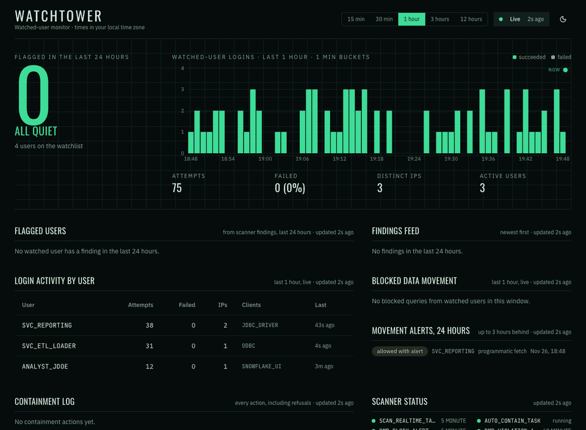
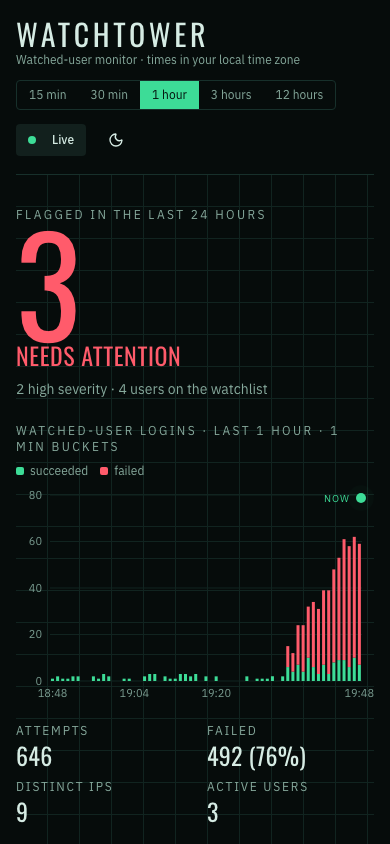

# Custom Trust Scanner (Snowflake demo)

A Trust Center-style scanner built with plain Snowflake objects (not a Native App extension).

| Scanner | Detects |
|---|---|
| `RECON_SYSTEM_USER` | Service users (`TYPE` = SERVICE / LEGACY_SERVICE) running `SHOW`/`DESCRIBE`/metadata-view queries across many object types |
| `MULTI_IP_LOGIN` | Users with successful logins from many distinct IPs in the lookback window |

New findings are stored in `FINDINGS` and emailed via `SYSTEM$SEND_EMAIL`. A task runs the scan hourly.

[`sql/06_realtime_scanner_information_schema.sql`](sql/06_realtime_scanner_information_schema.sql) adds a near-real-time scanner (`SCAN_REALTIME`, run by `SCAN_REALTIME_TASK` every 5 minutes) built on `INFORMATION_SCHEMA` table functions, so there is no `ACCOUNT_USAGE` latency. It only looks at users listed in `WATCHED_USERS` and writes to `FINDINGS`:

| Scanner | Detects |
|---|---|
| `RT_IP_HOPPING` | Successful logins from many distinct IPs |
| `RT_FAILED_LOGINS` | Repeated failed logins |
| `RT_LOGIN_BURST` | Sudden volume (default 50 attempts, success or failure, any number of IPs), many attempts from a single IP (default 20), or a spike versus the user's own baseline (default 5x) |
| `RT_UNEXPECTED_CLIENT` | Client types such as `PYTHON_DRIVER` instead of `ODBC`: checked against the per-user `EXPECTED_CLIENTS` allowlist when one exists, otherwise against the client types the user normally uses |
| `RT_RECON` | `SHOW`/`DESCRIBE`/metadata-view enumeration |

### Defining the watched population

- Add user names to `WATCHED_USERS` directly (`SOURCE = 'MANUAL'`).
- Or add role names to `WATCHED_ROLES`: `SYNC_WATCHED_ROLES()` runs at the start of every scan and adds everyone directly granted those roles (`SOURCE = 'ROLE'`), and removes them when the grant is revoked. Role hierarchies are not expanded, and manual rows are never touched.
- The data movement alerts (`04`, `05`) report only watched users too, so run `06` before them.

Thresholds are in `RT_CONFIG`. The task is created suspended; resume it with `ALTER TASK SCAN_REALTIME_TASK RESUME;`. `INFORMATION_SCHEMA` only covers the last 7 days and returns at most 10,000 rows per call, so very busy accounts can be truncated.

## Containment and Cortex Agent

[`sql/07_containment.sql`](sql/07_containment.sql) and [`agents/containment_agent.agent.yaml`](agents/containment_agent.agent.yaml) add guarded actions for flagged users. Everything is limited to the users in `WATCHED_USERS`.

- `CONTAIN_USER(user, action, requested_by, confirmed)` supports `ABORT_QUERIES`, `DISABLE_USER` and `ENABLE_USER`. It refuses users who are not on the watchlist, users listed in `PROTECTED_USERS` (add admins and break-glass accounts there), and `DISABLE_USER` unless `confirmed` is true. Every call, including refusals, is written to `CONTAINMENT_LOG`.
- `AUTO_CONTAIN()` (run by the suspended `AUTO_CONTAIN_TASK`) aborts running queries for users with `WATCHED_USERS.AUTO_CONTAIN = TRUE` who have a HIGH finding and findings from at least two different scanners in the last 60 minutes.
- The `CONTAINMENT_AGENT` Cortex Agent has two tools, `get_flagged_users` and `contain_user`. Its instructions require a human yes before it disables anyone. The `confirmed` flag is a guardrail, not authentication, and findings are treated as untrusted text.

The procedures run as owner (ACCOUNTADMIN in this demo) because `ALTER USER` needs it; use a dedicated role in production. Create the agent from the YAML (replace the placeholders) with `CREATE AGENT ... FROM SPECIFICATION`, and grant `USAGE` on the agent to the people who should chat with it.

## Real-time dashboard

[`dashboard/`](dashboard/) is a Snowflake App Runtime (Next.js) dashboard called Watchtower. It shows the watched users' login timeline, findings, blocked data movement, scanner status and the containment log, and lets an analyst abort queries, disable or re-enable a flagged user through `CONTAIN_USER`. See [`dashboard/README.md`](dashboard/README.md) for deploy steps and the owner's-rights caveat.

| Dark | Light | Mobile |
|---|---|---|
|  |  |  |

The images use synthetic demo data (made-up users and numbers), generated by [`dashboard/scripts/capture_demo.py`](dashboard/scripts/capture_demo.py). No real account data is shown.

## Data movement policy and violation alert

[`sql/03_data_movement_policy.sql`](sql/03_data_movement_policy.sql) creates a sample `PROGRAMMATIC_FETCH` policy (alert above 75 rows, block above 300) and attaches it to the account. It is account-wide, so review it before running; `ALTER ACCOUNT UNSET DATA MOVEMENT POLICY;` removes it.

[`sql/04_dmp_violation_alert.sql`](sql/04_dmp_violation_alert.sql) adds a Snowflake alert, `DMP_VIOLATION_ALERT`, that emails new rows from `SNOWFLAKE.ACCOUNT_USAGE.DATA_MOVEMENT_VIOLATIONS` every 60 minutes. It tracks the last notified time in `DMP_ALERT_STATE` so each violation is sent once. Violations appear in ACCOUNT_USAGE with up to 3 hours of latency.

[`sql/05_dmp_block_alert_realtime.sql`](sql/05_dmp_block_alert_realtime.sql) adds `DMP_BLOCK_ALERT_REALTIME`, which checks `INFORMATION_SCHEMA.QUERY_HISTORY` every 5 minutes for blocked queries (error 100168), so blocks are reported without the `ACCOUNT_USAGE` latency. It cannot see alert-only (allowed) events; the 04 alert covers those.

## Deploy (Snowflake CLI)

1. Edit `sql/01_deploy.sql`: replace `<YOUR_DB>`, `<YOUR_WAREHOUSE>`, `<YOUR_VERIFIED_EMAIL>` (must be a verified user email in the account).
2. `snow sql -c <connection> -f sql/01_deploy.sql`
3. `snow sql -c <connection> -f sql/02_demo_run.sql` (run inside the `TRUST_SCANNER` schema)
4. Optional alert: replace the same placeholders in [`sql/04_dmp_violation_alert.sql`](sql/04_dmp_violation_alert.sql), run it with `snow sql -c <connection> -f`, then `ALTER ALERT DMP_VIOLATION_ALERT RESUME;` (alerts are created suspended)
5. Optional real-time block alert: same steps with `sql/05_dmp_block_alert_realtime.sql`, then `ALTER ALERT DMP_BLOCK_ALERT_REALTIME RESUME;`
6. Optional real-time scanner: replace the placeholders (including `<YOUR_WATCHED_USER>`) in `sql/06_realtime_scanner_information_schema.sql` and run it after step 2
7. Optional containment and agent: replace the placeholders in `sql/07_containment.sql` and `agents/containment_agent.agent.yaml`, run the SQL after step 6, then create the agent
8. Optional dashboard: see `dashboard/README.md`
9. Cleanup: `sql/99_teardown.sql` (and `snow app teardown --force` for the dashboard)

Requires ACCOUNTADMIN (or equivalent) and `SNOWFLAKE.ACCOUNT_USAGE` access.

## Tuning
`SCANNER_CONFIG`: `LOOKBACK_HOURS` (24), `RECON_DISTINCT_MIN` (5), `IP_DISTINCT_MIN` (3).

## Limitations
`ACCOUNT_USAGE` latency: up to ~45 min (queries) / ~2 h (logins). Findings are not shown in the Trust Center UI.
Demo only; not a replacement for Snowflake Trust Center.
